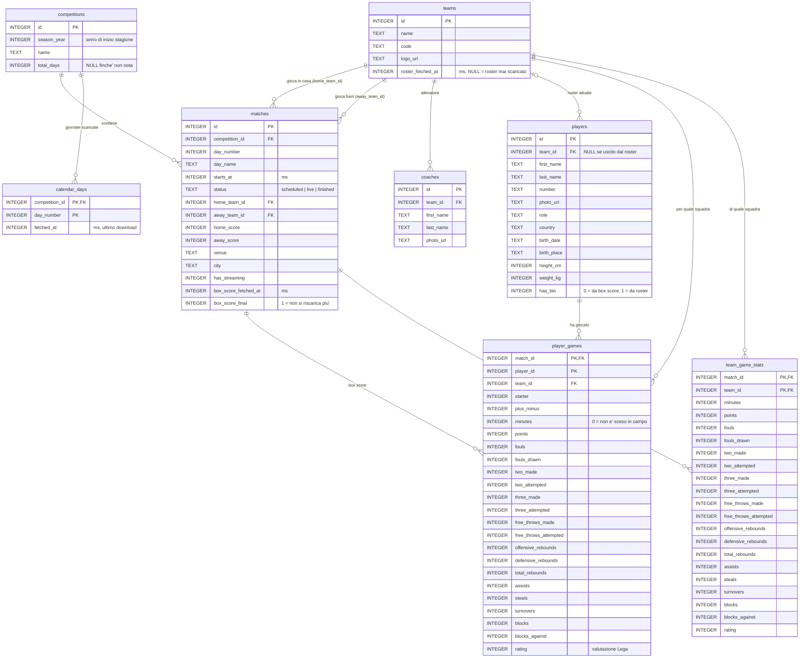

# Schema ER del database

Definizione in `src/infrastructure/db/schema.ts`. Sincronizzazione e query d'esempio in `docs/local-database.md`.

## Diagramma

Note sul diagramma:

- `player_games.player_id` non ha una vera foreign key verso `players`: una riga di box score può arrivare prima che il giocatore sia nel database. Il giocatore viene creato in quel momento dal box score stesso.
- Le foreign key sono dichiarate nello schema ma SQLite non le fa rispettare (`PRAGMA foreign_keys` è spento): servono come documentazione.
- `team_game_stats` comprende anche rimbalzi e palle perse "di squadra", quindi non è la semplice somma delle righe di `player_games`.

## Tabelle e colonne

Gli orari (`starts_at`, `fetched_at`, `roster_fetched_at`, `box_score_fetched_at`) sono timestamp in millisecondi. I booleani sono interi 0/1.

### `competitions`

Una riga per competizione scaricata (oggi solo la Regular Season Serie A di ogni stagione).

| Colonna | Tipo | Note |
|---|---|---|
| `id` | INTEGER, PK | id della Lega |
| `season_year` | INTEGER | anno di inizio stagione (2026 = 2026/27) |
| `name` | TEXT | es. "Regular Season 2026/27" |
| `total_days` | INTEGER, NULL | numero di giornate; NULL finché non scaricata la prima |

### `calendar_days`

Quali giornate sono state scaricate e quando. Serve a decidere se una giornata va riscaricata.

| Colonna | Tipo | Note |
|---|---|---|
| `competition_id` | INTEGER, PK, FK → `competitions.id` | |
| `day_number` | INTEGER, PK | numero di giornata |
| `fetched_at` | INTEGER | ultimo download |

### `teams`

| Colonna | Tipo | Note |
|---|---|---|
| `id` | INTEGER, PK | id della Lega |
| `name` | TEXT | |
| `code` | TEXT | sigla, es. "BOL" |
| `logo_url` | TEXT, NULL | |
| `roster_fetched_at` | INTEGER, NULL | NULL = roster mai scaricato |

### `coaches`

| Colonna | Tipo | Note |
|---|---|---|
| `id` | INTEGER, PK | |
| `team_id` | INTEGER, FK → `teams.id` | |
| `first_name` | TEXT | |
| `last_name` | TEXT | |
| `photo_url` | TEXT, NULL | |

### `players`

| Colonna | Tipo | Note |
|---|---|---|
| `id` | INTEGER, PK | |
| `team_id` | INTEGER, NULL, FK → `teams.id` | squadra attuale; NULL se non è più nel roster |
| `first_name` | TEXT | |
| `last_name` | TEXT | |
| `number` | TEXT | numero di maglia ("-" se ignoto) |
| `photo_url` | TEXT, NULL | |
| `role` | TEXT | ruolo; vuoto se non noto |
| `country` | TEXT | vuoto se non noto |
| `birth_date` | TEXT, NULL | |
| `birth_place` | TEXT, NULL | |
| `height_cm` | INTEGER, NULL | |
| `weight_kg` | INTEGER, NULL | |
| `has_bio` | INTEGER | 0 = creato dal box score (solo nome, numero, foto); 1 = anagrafica completa dal roster |

### `matches`

| Colonna | Tipo | Note |
|---|---|---|
| `id` | INTEGER, PK | |
| `competition_id` | INTEGER, FK → `competitions.id` | |
| `day_number` | INTEGER | giornata |
| `day_name` | TEXT | es. "4° Giornata" |
| `starts_at` | INTEGER | palla a due |
| `status` | TEXT | `scheduled`, `live` o `finished` |
| `home_team_id` | INTEGER, FK → `teams.id` | |
| `away_team_id` | INTEGER, FK → `teams.id` | |
| `home_score` | INTEGER, NULL | |
| `away_score` | INTEGER, NULL | |
| `venue` | TEXT, NULL | palazzetto |
| `city` | TEXT, NULL | |
| `has_streaming` | INTEGER | 1 se in streaming |
| `box_score_fetched_at` | INTEGER, NULL | ultimo download del box score; NULL = mai scaricato |
| `box_score_final` | INTEGER | 1 = box score definitivo, non si riscarica più |

### `player_games`

Una riga per ogni giocatore a referto in ogni partita, anche chi non è sceso in campo (`minutes = 0`).

| Colonna | Tipo | Note |
|---|---|---|
| `match_id` | INTEGER, PK, FK → `matches.id` | |
| `player_id` | INTEGER, PK | senza FK verso `players` (vedi note sul diagramma) |
| `team_id` | INTEGER, FK → `teams.id` | squadra per cui ha giocato quella partita |
| `starter` | INTEGER | 1 se in quintetto base |
| `plus_minus` | INTEGER | |
| `minutes` | INTEGER | minuti giocati |
| `points` | INTEGER | |
| `fouls` | INTEGER | falli commessi |
| `fouls_drawn` | INTEGER | falli subiti |
| `two_made` / `two_attempted` | INTEGER | tiri da 2 |
| `three_made` / `three_attempted` | INTEGER | tiri da 3 |
| `free_throws_made` / `free_throws_attempted` | INTEGER | tiri liberi |
| `offensive_rebounds` | INTEGER | |
| `defensive_rebounds` | INTEGER | |
| `total_rebounds` | INTEGER | |
| `assists` | INTEGER | |
| `steals` | INTEGER | palle recuperate |
| `turnovers` | INTEGER | palle perse |
| `blocks` | INTEGER | stoppate date |
| `blocks_against` | INTEGER | stoppate subite |
| `rating` | INTEGER | valutazione Lega |

### `team_game_stats`

Una riga per squadra per partita, con i totali ufficiali. Ha le stesse colonne statistiche di `player_games` (da `minutes` a `rating`, stesso significato) e comprende rimbalzi e palle perse di squadra.

| Colonna | Tipo | Note |
|---|---|---|
| `match_id` | INTEGER, PK, FK → `matches.id` | |
| `team_id` | INTEGER, PK, FK → `teams.id` | |
| `minutes` … `rating` | INTEGER | le 19 colonne statistiche elencate sopra in `player_games`, da `minutes` a `rating` |

## Viste

Non contengono dati: sono query salvate sulle tabelle sopra. Considerano solo partite con `status = 'finished'`, così i dati di partite non concluse non entrano nei conteggi (i box score live non vengono comunque salvati).

| Vista | Una riga è… | Costruita da |
|---|---|---|
| `team_games` | una squadra in una partita conclusa, dal suo punto di vista (`team_id`, `opponent_id`, `is_home`, `team_score`, `opponent_score`, `won`) | `matches`, due volte (casa e trasferta) |
| `player_season_totals` | un giocatore in una competizione: `games` (solo partite con `minutes > 0`) e la somma di ogni statistica | `player_games` + `matches` |
| `team_season_totals` | una squadra in una competizione: `games` e la somma di ogni statistica | `team_game_stats` + `matches` |

Colonne:

- `team_games`: `match_id`, `competition_id`, `day_number`, `starts_at`, `team_id`, `opponent_id`, `is_home` (1/0), `team_score`, `opponent_score`, `won` (1/0).
- `player_season_totals`: `competition_id`, `player_id`, `games`, poi le 19 colonne statistiche di `player_games` (da `minutes` a `rating`), ciascuna come somma sulla stagione.
- `team_season_totals`: `competition_id`, `team_id`, `games`, poi le stesse 19 colonne statistiche, sommate.

Le somme sono totali, non medie: per la media si divide per `games`.

## Indici

| Tabella | Indice su |
|---|---|
| `competitions` | `season_year` |
| `coaches` | `team_id` |
| `players` | `team_id` |
| `matches` | `(competition_id, day_number)`, `home_team_id`, `away_team_id`, `starts_at` |
| `player_games` | `player_id`, `team_id` |
| `team_game_stats` | `team_id` |
